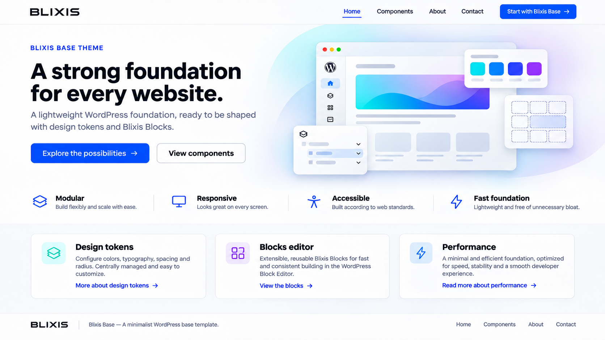

# Blixis WordPress

[](https://github.com/EmVeeNL/blixis-wordpress/actions/workflows/php-lint.yml)
[](docs/roadmap/ROADMAP.md)
[](https://wordpress.org/)
[](themes/blixis-base/style.css)
[](docs/README.md)

**Blixis** is a planned WordPress theme and visual content platform. Its architecture combines a neutral **Blixis Base** parent theme, site-specific child themes, the **Blixis Blocks** editor, and a controlled Content API. The first client implementation is planned for **Wilde Groei**.

> **Current state:** This repository contains a minimal WordPress block theme, a plugin entry point, local integration scripts, and project documentation. The child-theme wizard, visual editor, element renderer, and Content API are planned; the preview below is a concept image, not a screenshot of working software.



*Concept preview supplied for the Blixis Base vision. It does not represent the current theme output.*

**Keywords:** `wordpress` · `block-theme` · `page-builder` · `design-tokens` · `tailwindcss-v4` · `react` · `content-api`

**Maintainer:** Michael ([@EmVeeNL](https://github.com/EmVeeNL))

## What exists today

| Area | Current state | Next step |
|---|---|---|
| Blixis Base | Minimal discoverable block theme; inactive in the local site | Templates, token mapping, Tailwind build, and accessibility work |
| Blixis Blocks | Installable plugin entry point; no editor UI | Versioned registry, editor, persistence, and PHP rendering |
| Child themes | Planned | Generator, validated token setup, and preview |
| Content API | Proposed, not implemented | Approve access model and build read-only published-content routes |
| Quality checks | GitHub Actions checks PHP syntax and documentation links/task metadata | Add feature-specific lint, tests, builds, and security checks as code arrives |

See the [PRD](docs/architecture/PRD.md), [MVP scope](docs/roadmap/MVP.md), and [roadmap](docs/roadmap/ROADMAP.md) for the intended product and sequence. A documented plan is not an implementation claim.

## Local development

The source checkout and the running WordPress installation are deliberately separate:

```text
~/Developer/WordPress/blixis-wordpress/   # Blixis-owned source (this repository)
~/Sites/blixis/                            # Local WordPress Core, content, and configuration
```

The existing local site uses the Docker Compose project `blixis` and MariaDB volume `blixis_mariadb_data`. Keep its database, uploads, `.env`, and `wp-config.php` in the runtime installation. This repository does not install WordPress Core or create a new site for you.

### Prerequisites

- A working local WordPress installation and WP-CLI for the verification commands below.
- PHP 8.2 or newer for the current theme and plugin headers. The full supported-version matrix is still [provisional](docs/development/SUPPORT_MATRIX.md).
- Docker Compose only if you use the included MariaDB service definition.

### Link the Blixis components

From the source checkout:

```bash
bash scripts/setup-links.sh
wp core is-installed --path="$HOME/Sites/blixis"
wp theme list --path="$HOME/Sites/blixis"
wp plugin list --path="$HOME/Sites/blixis"
```

`setup-links.sh` links `themes/blixis-base` and `plugins/blixis-blocks` into the local site. It is safe to rerun and stops if a different file or link already occupies either destination. Set `BLIXIS_WP_PATH` to an **absolute** WordPress path before running the script if your site is elsewhere. Linking does not activate the theme or plugin.

To inspect the existing database service without changing it:

```bash
docker compose --env-file "$HOME/Sites/blixis/.env" -f compose.yaml config --quiet
docker compose --env-file "$HOME/Sites/blixis/.env" -f compose.yaml ps
```

Read [configuration](docs/development/CONFIGURATION.md) and the [migration record](docs/development/MIGRATION.md) before changing local infrastructure. Never put runtime credentials, uploads, or database dumps in this repository.

## Repository map

```text
themes/blixis-base/       Minimal parent block theme
plugins/blixis-blocks/    Plugin entry point
scripts/                  Safe local links and documentation validation
docs/                     Product, architecture, development, security, and roadmap
.github/workflows/        Current PHP syntax and documentation checks
compose.yaml              MariaDB service with a stable Compose project name
```

The `docs/elements/` JSON files and `docs/examples/` are **specifications and examples**, not production registry code. Future workspaces should be introduced with their first real consumers.

## Documentation and roadmap

- [Documentation index](docs/README.md) — guide to all project documents.
- [Architecture](docs/architecture/ARCHITECTURE.md), [decisions](docs/architecture/DECISIONS.md), and [open questions](docs/architecture/OPEN_QUESTIONS.md).
- [Blixis Base and child themes](docs/development/TEMPLATE.md), [editor](docs/architecture/EDITOR.md), [element registry](docs/architecture/ELEMENTS.md), and [API proposal](docs/architecture/API.md).
- [Roadmap](docs/roadmap/ROADMAP.md) — nine phases with individual task files, dependencies, status, acceptance criteria, and testing requirements.
- [Security and performance](docs/security/SECURITY_AND_PERFORMANCE.md), [Git and CI workflow](docs/development/GIT.md), and [contributing](CONTRIBUTING.md).

## Contributing

Michael ([@EmVeeNL](https://github.com/EmVeeNL)) owns the roadmap tasks. Follow [AGENTS.md](AGENTS.md), the relevant task file, and [Contributing](CONTRIBUTING.md). Use a task branch from `main`, Conventional Commits, and a PR with exact test results. Update task status only when its evidence supports the transition.

This repository has no published release of the planned editor or API. The current source license has not yet been specified in a `LICENSE` file; ask the maintainer before reusing code or assets outside this project.
