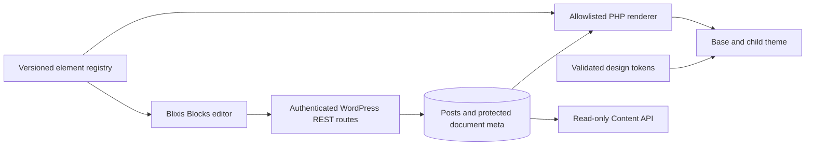

# Architecture

## Status and system boundary

**Implemented:** this repository contains a minimal `blixis-base` block theme, a `blixis-blocks` plugin entry point, a link script, and a MariaDB Compose definition. The active site is `~/Sites/blixis`; its Core, uploads, configuration, and database remain outside this source checkout. The Blixis theme and plugin are linked into that site but are inactive. No editor, token generator, content renderer, or Content API exists yet.

**Planned architecture:** Blixis Base is a versioned parent theme. Site branding belongs in a child theme. Blixis Blocks owns the editor, element registry, versioned document, persistence, and rendering. A separately deployable Content API module exposes deliberately published content. WordPress owns posts, permissions, revisions, and publication state.

## Ownership and dependency rules

Task 01-05 [reviewed](reviews/01-05-integration.md) these boundaries; the accepted design contracts are in [`docs/contracts`](../contracts/README.md) and the [related ADRs](DECISIONS.md). Product implementation remains planned.

| Data or behavior | Owner | Must not |
|---|---|---|
| Post title, slug, status, author, dates, permissions, revisions | WordPress | Be copied into or overridden by the document |
| `_blixis_document` and its schema, validator, and migrations | Blocks | Be reachable through generic REST, XML-RPC, or the Content API |
| `post_content` | Blocks writes it as a derived projection of the live document | Be treated as authoritative on a Blixis page |
| Element registry, renderer, compiled utilities | Blocks, released together | Accept class names or markup from input |
| `BlixisThemeConfig`, its validator and generator | Tokens module inside Blocks; PHP is the only generator | Depend on React or write into a theme |
| Neutral templates and default presets | Base | Hold site values or receive writes |
| Branding files and approved overrides | Child theme | Be the canonical token store |
| Editor and preview UI | Blocks admin only | Load on public pages |
| `blixis/v1` routes, API keys, quotas | Content API module, read-only | Write documents or accept WordPress identity as authorization |

Data flow: the editor saves a validated document through `blixis-editor/v1`. On a live page, a save goes to the user's autosave revision; publishing promotes it, and writes the document and projection together. Public pages, core REST, feeds, search, and the Content API read published data only.

- `themes/blixis-base` owns neutral templates, semantic structure, and theme contracts. The UI must never edit parent source.
- A future child theme owns site branding and approved overrides. The proposed Wilde Groei site belongs there, not in Base.
- `plugins/blixis-blocks` owns editor and document routes. Keep the editor JavaScript out of public pages.
- The future API has its own permission and key boundary. Do not expose protected post meta through a generic route.
- Introduce shared packages when implemented: schema/element contracts independent of React, tokens independent of UI, editor depending on contracts, and PHP renderer validating against the same versioned contract. Do not create empty packages.

## Document and rendering contract (planned)

Store a versioned node graph in protected `_blixis_document` post meta. WordPress post fields remain authoritative for title, slug, status, author, and publication date. `post_content` holds a derived, non-authoritative projection of the document as one `core/html` block, with `[` and `]` written as numeric entities, so search, excerpts, feeds, and plugin deactivation keep working without running shortcodes in user text. A page with a document belongs to Blixis. Each node has a stable ID, `type`, element `version`, props, responsive overrides, and child references. Server validation must reject unknown props, missing references, cycles, invalid nesting, and excessive size/depth. Explicitly configure and test post-meta revision support; do not assume it is automatic.

Public HTML is server rendered from an allowlist with contextual escaping, semantic markup, and asset loading. React runs in admin. Preview must match renderer semantics; use contract fixtures and visual regression tests. Unknown versions must preserve stored bytes: a future `schemaVersion` serves the projection and refuses writes; an unknown node renders as nothing, and a write may carry it only unchanged. Validate on every read, because revision restore bypasses the write path. Hook `the_content` after core's filters and honor `post_password_required()`. Schema migrations need pure transformations, golden fixtures, and a rollback/export path.

## Tokens and responsive model (planned)

A validated `BlixisThemeConfig` is the intended canonical site configuration; see the [token contract](../contracts/tokens/README.md). Generate `theme.json` mappings and CSS from it; do not hand-edit divergent copies. Tailwind CSS v4 builds utilities known at build time: import `tailwindcss/utilities.css` unlayered with no preflight, after WordPress global styles, and map tokens with `@theme inline`. Safe runtime CSS custom properties may change colors and spacing without recompilation; new utility names and breakpoint variants require a build. MVP uses fixed breakpoints (40, 48, 64, and 80rem); they are build inputs, because a runtime `var()` in a media query never matches. Resolve node overrides mobile-first and write to a breakpoint only when the editor explicitly enters that editing context. Device width presets are preview controls.

## Editor and publication (planned)

Use WordPress cookie authentication plus a REST nonce and post-specific capabilities for editor requests. Local immutable tree state needs undo/redo, dirty state, and conflict detection through an `If-Match` hash of the stored document, re-checked under a post-row lock in the write transaction. Autosave must never publish. Draft edits of a live page live in the user's autosave revision until an explicit publish that requires `edit_post` and `publish_pages`. Restoring a revision is a publication and needs that treatment in the interface. A draft preview is authenticated in MVP under [ADR-005](decisions/ADR-005-review-security.md); external review links need a later decision. [ADR-006](decisions/ADR-006-editor-and-gutenberg.md) assigns ownership by document presence rather than a separate mode field.

## Cross-cutting contracts

See [security and performance](../security/SECURITY_AND_PERFORMANCE.md), [API plan](API.md), [element registry](ELEMENTS.md), [token configuration](../development/CONFIGURATION.md), and [decisions](DECISIONS.md). The [approved target support matrix](../development/SUPPORT_MATRIX.md) records compatibility evidence; theme and plugin headers require WordPress 7.0 and PHP 8.3, with disposable activation tests in task 02-01.
