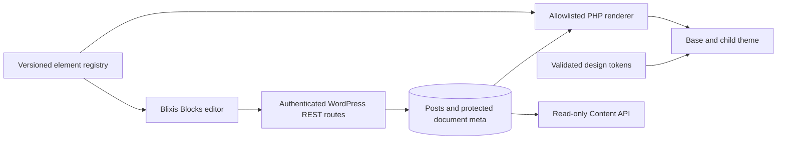

# Architecture

## Status and system boundary

**Implemented:** this repository contains a minimal `blixis-base` block theme, a `blixis-blocks` plugin entry point, a link script, and a MariaDB Compose definition. The active site is `~/Sites/blixis`; its Core, uploads, configuration, and database remain outside this source checkout. The Blixis theme and plugin are linked into that site but are inactive. No editor, token generator, content renderer, or Content API exists yet.

**Planned architecture:** Blixis Base is a versioned parent theme. Site branding belongs in a child theme. Blixis Blocks owns the editor, element registry, versioned document, persistence, and rendering. A separately deployable Content API module exposes deliberately published content. WordPress owns posts, permissions, revisions, and publication state.

## Ownership and dependency rules

- `themes/blixis-base` owns neutral templates, semantic structure, and theme contracts. The UI must never edit parent source.
- A future child theme owns site branding and approved overrides. The proposed Wilde Groei site belongs there, not in Base.
- `plugins/blixis-blocks` owns editor and document routes. Keep the editor JavaScript out of public pages.
- The future API has its own permission and key boundary. Do not expose protected post meta through a generic route.
- Introduce shared packages when implemented: schema/element contracts independent of React, tokens independent of UI, editor depending on contracts, and PHP renderer validating against the same versioned contract. Do not create empty packages.

## Document and rendering contract (planned)

Store a versioned node graph in protected `_blixis_document` post meta. WordPress post fields remain authoritative for title, slug, status, author, and publication date. Each node has a stable ID, `type`, element `version`, props, responsive overrides, and child references. Server validation must reject unknown props, missing references, cycles, invalid nesting, and excessive size/depth. Explicitly configure and test post-meta revision support; do not assume it is automatic.

Public HTML is server rendered from an allowlist with contextual escaping, semantic markup, and asset loading. React runs in admin. Preview must match renderer semantics; use contract fixtures and visual regression tests. Unknown versions must preserve stored content and fail safely. Schema migrations need pure transformations, golden fixtures, and a rollback/export path.

## Tokens and responsive model (planned)

A validated `BlixisThemeConfig` is the intended canonical site configuration. Generate `theme.json` mappings and CSS from it; do not hand-edit divergent copies. Tailwind CSS v4 uses CSS-first `@import "tailwindcss"` and `@theme` for utilities known at build time. Safe runtime CSS custom properties may change colors and spacing without recompilation; new utility names and breakpoint variants require a build. MVP uses fixed breakpoint presets. Resolve node overrides mobile-first and write to a breakpoint only when the editor explicitly enters that editing context. Device width presets are preview controls.

## Editor and publication (planned)

Use WordPress cookie authentication plus a REST nonce and post-specific capabilities for editor requests. Local immutable tree state needs undo/redo, dirty state, and conflict detection against a revision or ETag. Autosave must never publish. A draft preview is authenticated in MVP; external review links remain proposed in [ADR-005](decisions/ADR-005-review-security.md). The page ownership policy relative to Gutenberg remains proposed in [ADR-006](decisions/ADR-006-editor-and-gutenberg.md).

## Cross-cutting contracts

See [security and performance](../security/SECURITY_AND_PERFORMANCE.md), [API plan](API.md), [element registry](ELEMENTS.md), [token configuration](../development/CONFIGURATION.md), and [decisions](DECISIONS.md). The exact WordPress/PHP/Node support matrix is open until the compatibility spike.
