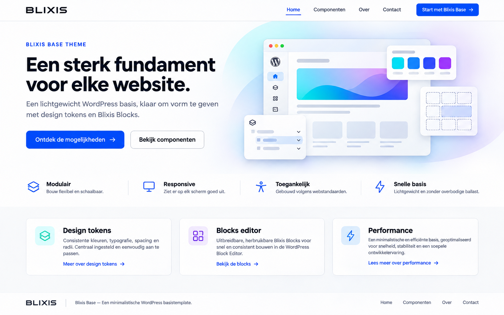

# Blixis Base and child themes

**Implemented:** `themes/blixis-base` has `style.css`, `theme.json`, and a minimal index template. It is discoverable in the local WordPress installation but inactive. There is no child-theme generator or Tailwind build yet.

**Planned:** Base provides neutral structure, semantic templates, accessible markup, and token contracts. A site child theme owns branding, fonts, variants, and overrides. Never write site-specific changes into Base through the setup UI. Template targets include page, single, archive, search, and 404, with header/footer parts and a skip link. Base should still load safely when Blocks is inactive.

The image is a concept illustration, not a capture of a working theme. It belongs to a separate showcase, not every new site's default content. See [token configuration](CONFIGURATION.md) and [theme roadmap](../roadmap/phases/02-blixis-base-theme/_index.md).
